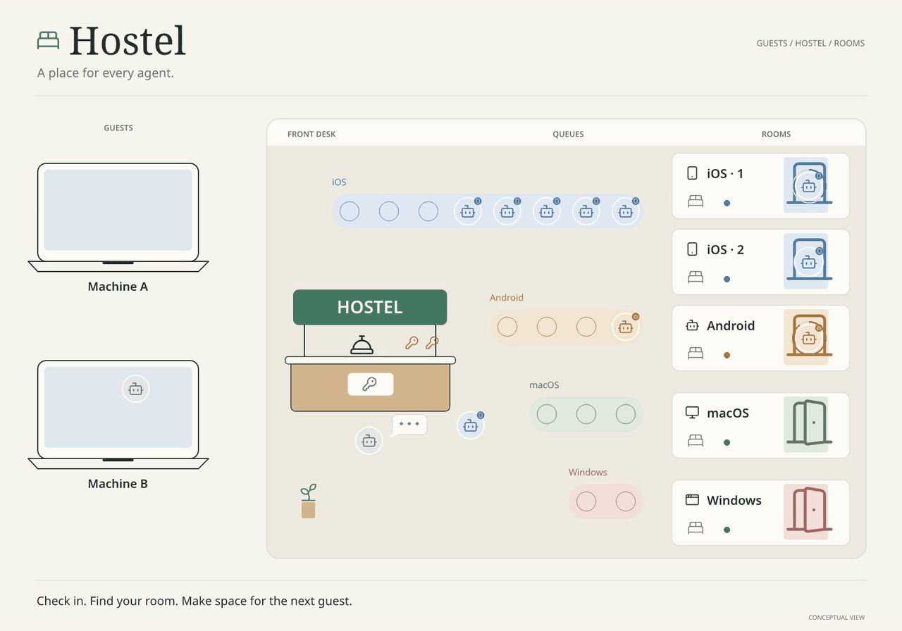

# Hostel

Short, temporary, exclusive access to remote machines for coding agents.



Coding agents edit code on your computer. When they need another machine for a
build, a UI check, or a device test (an Android SDK, an iOS simulator, an Android
emulator, a macOS or Windows desktop app, Linux), they ask Hostel for a **lease**
with the **tools** that they need. The Hostel server keeps one waiting line,
gives the agent a **room** on a machine (one of your
computers, or an on-demand cloud machine), and cleans the room when the lease ends
(caches stay, so the next build is fast). The agent's code stays local: Hostel sends the changed files.

- Many agents, many people, few machines: leases are exclusive and wait in line, with
  priorities and wait estimates.
- Your own computers (a Mac, a Windows PC, a Linux box; also behind NAT) and
  on-demand machines (Namespace, or your own provider script).
- Tools for Android, iOS, macOS, Windows, and Linux: a build needs no screen,
  and a lease that asks for one gets a clean emulator, simulator, or desktop,
  with screenshots, desktop app control, and tunnels from the machine to your local
  servers.

## Install

macOS and Linux:

```sh
curl -fsSL https://raw.githubusercontent.com/csansoon/hostel/main/install.sh | sh
```

Windows (PowerShell):

```powershell
irm https://raw.githubusercontent.com/csansoon/hostel/main/install.ps1 | iex
```

Both install the latest [release](https://github.com/csansoon/hostel/releases)
and check it against its `SHA256SUMS`. To update, run `hostel update` (from
v0.2.0; it checks the release signature), or choose Update in the app.

## For humans

Run `hostel` in a terminal. It opens the Hostel app:

```sh
hostel
```

- **Check in**: the first time, paste the invite code that an admin of your
  server gave you. The app connects your computer, and your agents use the same
  connection.
- **Front desk**: Guests (admins invite people and change roles; everyone can
  make a code for their other computer), This server (address, version, and
  Update the server for admins, when a newer release exists), and Check out.
- **Lobby**: the one waiting line first (each queued lease, in order, with its
  estimated wait), then Screens (one line each: vacancy, machines, waiting), then
  Software in a short wrapped list. Enter on a tool opens its options, machines,
  and waiting leases; enter on a waiting lease opens the page of its first tool.
  Admins move entries and change priorities there.
- **Rooms**: one list, provider › machine › room. Rooms are small squares by the
  machine (blue occupied, green vacant, yellow in setup or cleanup, red broken).
  Each room has one line: the guest, "Vacant", or its state. Gauges show the CPU and memory use.
  Enter opens the machine (hardware, live use, leases with branch and running
  job), the room page, an on-demand provider, or a template. You can end your own
  lease; admins can end any lease. Admins press `a` for the machine actions (stop
  new leases, repair) and `+` to add a machine.
- **Update**: shows in the menu when a newer release exists; it installs it on
  this computer.

The footer shows what the selected item is and which keys work. `?` lists all
keys; `1` `2` `3` jump to Front desk, Lobby, and Rooms; `q` quits.

### Your own server

No server yet? Ask your coding agent to set one up with the skills below, for
example:

> Read the skills at https://github.com/csansoon/hostel/tree/main/skills and set
> up Hostel for me: a server on my VPS, my Mac as an iOS machine, and an invite for
> me.

Or do it yourself on a Linux machine that your computers can reach:

```sh
curl -fsSL https://raw.githubusercontent.com/csansoon/hostel/main/install.sh | sudo sh -s -- --dir /opt/hostel/bin --server /opt/hostel
sudo chown -R "$USER" /opt/hostel && sudo ln -sf /opt/hostel/bin/hostel /usr/local/bin/hostel
hostel server init --listen 0.0.0.0:7410 --url https://hostel.example.com:7410 --helper-dir /opt/hostel/helpers
hostel server run
```

Run `hostel server init` and `hostel server run` as the user of the service (not
root), and open TCP 7410.
`hostel server init` prints the invite code for your computer; use it within 24
hours. Then open the app and add your machines: Rooms, then `+`. The
[`hostel-server-setup`](skills/hostel-server-setup/SKILL.md) skill has the
details (a service, a proxy with TLS, backups, updates: an admin updates the
server from the app, in Front desk › This server › Update the server).

## For agents

Agents use the `hostel <verb>` commands, never the app. Hostel comes with skills
in [`skills/`](skills/), in the `SKILL.md` format that Claude Code, Codex, and
other agents read. Start with [`hostel`](skills/hostel/SKILL.md): it says which
skill fits a task.

- [**`hostel-install`**](skills/hostel-install/SKILL.md): install or update the
  CLI on macOS, Linux, or Windows (`hostel update`); connect a computer with an invite code
  (`hostel connect hostel1-…`); check it with `hostel --version` and
  `hostel status`.
- [**`hostel-server-setup`**](skills/hostel-server-setup/SKILL.md): run a server
  on a VPS or a machine at home: `hostel server init` (its own TLS, or behind a
  proxy), a systemd service, the configuration in the database
  (`hostel config edit`), backups, updates (`hostel server update`).
- [**`hostel-machines`**](skills/hostel-machines/SKILL.md): add machines: over SSH, from
  behind NAT (`hostel config machines add`, then `hostel machine join` on the
  machine), or on demand (Namespace, or an `external` provider); limits, warm
  machines, drain, repair, remove; offline machines.
- [**`hostel-tools`**](skills/hostel-tools/SKILL.md): the tools of a machine
  (`android-sdk`, `android-emulator`, `xcode`, `ios-simulator`, `macos-desktop`,
  `windows-desktop`, and any mise tool such as `jdk:21`), what each needs on the
  machine (Xcode; KVM on Linux for the emulator; a desktop session), options,
  and your own tools with their scripts.
- [**`hostel-users`**](skills/hostel-users/SKILL.md): invite people
  (`hostel config users invite`), roles (admin, member), a code for another
  computer, remove a user or one computer.
- [**`hostel-use`**](skills/hostel-use/SKILL.md): the work loop:
  `hostel tools`, `hostel acquire <tool[:option]>... --task "…"` (exit code 75:
  run it again), `hostel run`, `hostel sync`, `hostel screenshot`, `hostel release`;
  `hostel.toml` in a repository for its usual tools, setup commands, and tunnels
  to a local API.
- [**`hostel-troubleshoot`**](skills/hostel-troubleshoot/SKILL.md): machine and lease
  states, offline and broken machines, repair and changed host keys, logs,
  common errors (exit codes 69 and 78, a changed TLS key).

A typical lease:

```sh
hostel tools
hostel acquire ios-simulator:iphone-17-pro --task "check the sign-in screen"
hostel run -- 'xcodebuild test -scheme MyApp -destination "id=$SIMULATOR_UDID"'
hostel screenshot -o screen.png
hostel release
```

`hostel agent-guide` prints the instructions for agents that come with the
installed version. To make your agents use Hostel, add this
to their instructions file (for example `AGENTS.md` or `CLAUDE.md`):

```markdown
## Remote machines (Hostel)

This computer can borrow remote machines for builds, UI QA, and device tests.
Before the first use in a session, run `hostel agent-guide` and follow it. Ask
only for the tools that you need; ask for a screen tool only to see the app. Always run `hostel release` when you are done.
```

## Documentation

| Document | Content |
|---|---|
| [docs/design.md](docs/design.md) | Architecture and contracts |
| [docs/requirements.md](docs/requirements.md) | Vocabulary, decisions, requirements |
| [docs/deploy-vps.md](docs/deploy-vps.md) | A server on a VPS |
| [docs/machine-setup.md](docs/machine-setup.md) | Your own computers as machines |
| [docs/namespace.md](docs/namespace.md) | On-demand machines on Namespace |
| [docs/plan.md](docs/plan.md) | Milestones |
| [AGENTS.md](AGENTS.md) | Rules for coding agents that work on Hostel itself |

Status: version 0.3. Milestones M0 to M10e are done; M11 (hardening against
backdoors) is planned. See [docs/plan.md](docs/plan.md).

## License

[MIT](LICENSE)
